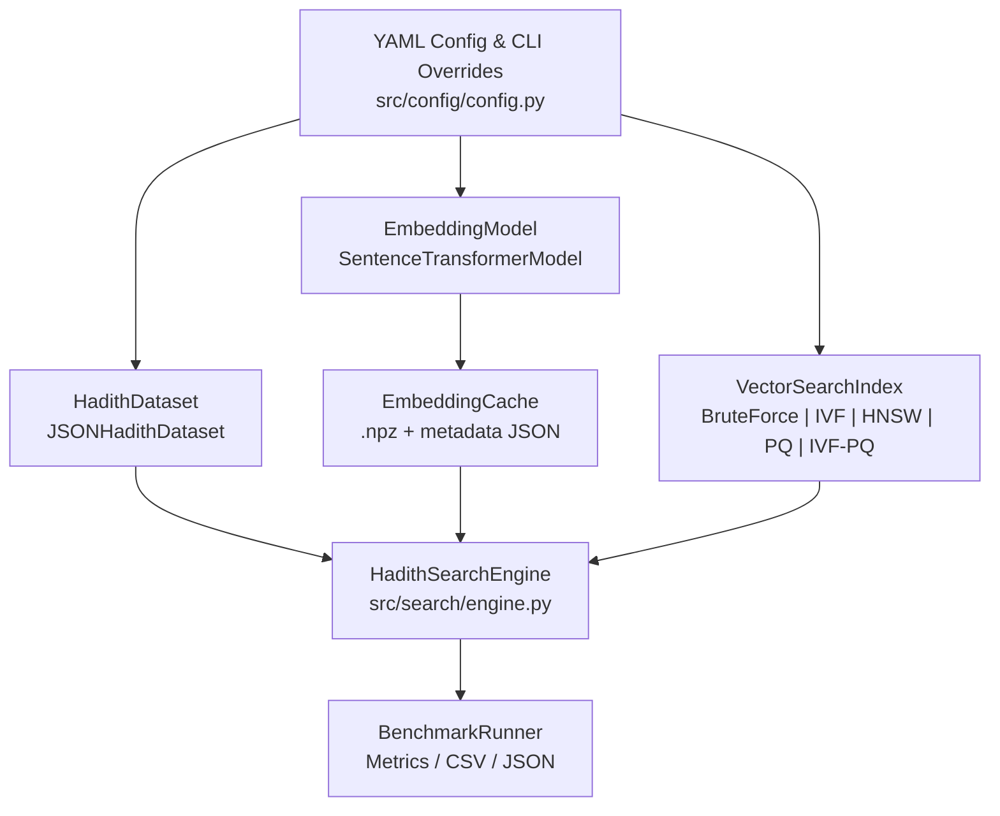

# Hadith Semantic Retrieval

[](https://www.python.org/downloads/)
[](https://huggingface.co/sentence-transformers/paraphrase-multilingual-MiniLM-L12-v2)
[](#search-algorithms)

A local, modular **semantic search and vector-index benchmarking framework** for Arabic Hadith retrieval.

This project encodes Hadith collections into dense multilingual sentence embeddings, builds and persists five vector-search index implementations behind a unified interface, and benchmarks their **latency, Recall@K, build time, and memory footprint** to guide algorithm selection for offline/mobile (Android) deployment.

---

## Key Features

- **Arabic & Multilingual Semantic Retrieval** — Uses `paraphrase-multilingual-MiniLM-L12-v2` (384-dim, L2-normalized) via `sentence-transformers` with automatic embedding caching (`.npz` + metadata validation).
- **Five Vector Search Algorithms** — Unified `VectorSearchIndex` interface covering **Brute Force**, **IVF**, **HNSW** (`hnswlib`), **Product Quantization (PQ)** with Asymmetric Distance Computation, and **IVF+PQ**.
- **Reproducible Benchmarking** — Evaluates every index against Brute Force exact ground truth with warm-up queries, Recall@K, Precision@K, P50/P95/P99 latency, and automatic CSV + JSON exports.
- **Clean, Extensible Architecture** — Factory registry (`VectorSearchFactory`), typed YAML configuration (`configs/default.yaml`) with CLI `--set` overrides, dependency injection, and structured logging.
- **Mobile-Ready Research Pipeline** — Separates offline index construction from runtime search assets (ONNX embeddings + serialized index binaries) for Android portability.

---

## Architecture



- **No algorithm-specific branching outside the factory** — `HadithSearchEngine` interacts solely with the `VectorSearchIndex` abstract interface.
- **Lazy model loading** — Transformer weights are only loaded when encoding queries or generating embeddings.
- **Adding a new index** — Implement `VectorSearchIndex` in `src/indexes/` and register it in `VectorSearchFactory` (`src/indexes/factory.py`).

---

## Search Algorithms

| Algorithm | Method | Build Complexity | Search Complexity | Compression | Best Use Case |
| :--- | :--- | :--- | :--- | :--- | :--- |
| **`brute_force`** | Exact matrix dot-product scan | $O(1)$ | $O(N \cdot D)$ | None (float32) | Ground truth & small corpora (<10K) |
| **`ivf`** | K-Means Voronoi partitioning + inverted lists | $O(N \cdot K \cdot D)$ | $O(K \cdot D + \frac{N \cdot n_{\text{probe}}}{K} \cdot D)$ | None (float32) | Medium datasets with tunable `nprobe` |
| **`hnsw`** | Multi-layer navigable small-world graph (`hnswlib`) | $O(N \cdot M \log N)$ | $O(\log N \cdot ef_{\text{search}} \cdot M)$ | None (+ graph edges) | Best recall/latency tradeoff; recommended for Android |
| **`pq`** | Subspace K-Means quantization + ADC table lookup | $O(M \cdot N \cdot K \cdot \frac{D}{M})$ | $O(N \cdot M)$ lookups | High ($N \cdot M$ bytes) | Strictly memory-constrained environments |
| **`ivf_pq`** | Coarse IVF clustering + PQ-compressed residuals | IVF + PQ | $O(K \cdot D + \frac{N \cdot n_{\text{probe}}}{K} \cdot M)$ | High | Large corpora (>100K) needing speed + low RAM |

---

## Benchmark Results

Measured on the bundled sample dataset (**500 Hadiths**, 384-dim `paraphrase-multilingual-MiniLM-L12-v2`, 20 queries, `k=10`, seed `42` — see [`data/benchmark_results/benchmark_20260901_115953.csv`](data/benchmark_results/benchmark_20260901_115953.csv)):

| Algorithm | Build Time (s) | Avg Latency (ms) | P50 (ms) | P95 (ms) | Recall@10 | Index Size (MB) |
| :--- | ---: | ---: | ---: | ---: | ---: | ---: |
| `brute_force` | 0.000 | 0.037 | 0.031 | 0.055 | 1.000 | 0.74 |
| `ivf` | 0.630 | 0.043 | 0.040 | 0.059 | 0.865 | 1.11 |
| `hnsw` | 0.015 | 0.052 | 0.051 | 0.059 | 0.925 | 0.81 |
| `pq` | 1.284 | 0.086 | 0.076 | 0.133 | 0.935 | 0.38 |
| `ivf_pq` | 1.422 | 0.078 | 0.078 | 0.087 | 0.900 | 0.48 |

> **Note:** At 500 vectors, vectorized NumPy brute force is already sub-millisecond. The latency and memory advantages of **HNSW**, **IVF**, and **IVF+PQ** become pronounced as the corpus scales to 10K–100K+ Hadiths.

---

## Quick Start

### 1. Installation

```bash
git clone https://github.com/marwanviper/hadith-semantic-retrieval.git
cd hadith-semantic-retrieval

python -m venv .venv
# Windows (PowerShell):
.\.venv\Scripts\Activate.ps1
# Linux / macOS:
# source .venv/bin/activate

pip install -r requirements.txt
```

### 2. End-to-End Workflow

```bash
# 1. Generate the 500-Hadith sample dataset (or place your own at data/raw/hadiths.json)
python app.py prepare

# 2. Compute and cache embeddings (~120 MB model download on first run)
python app.py embeddings

# 3. Build one or all vector indexes
python app.py build --algorithm all

# 4. Run a semantic search query in Arabic
python app.py search --algorithm hnsw --query "حديث عن الأعمال بالنية" --top-k 5

# 5. Run the full benchmark suite (saves CSV & JSON to data/benchmark_results/)
python app.py benchmark --algorithm all
```

---

## CLI Reference

Global options (`--config`, `--log-level`, `--set`) apply before the subcommand:

```bash
python app.py [--config PATH] [--log-level LEVEL] [--set KEY=VALUE ...] <command> [options]
```

| Command | Description | Example |
| :--- | :--- | :--- |
| `prepare` | Create or validate `data/raw/hadiths.json` | `python app.py prepare` |
| `embeddings` | Encode Hadiths and save to `data/processed/embeddings.npz` | `python app.py embeddings --force` |
| `build` | Build index (`brute_force`, `ivf`, `hnsw`, `pq`, `ivf_pq`, `all`) | `python app.py build --algorithm hnsw` |
| `search` | Search with an Arabic query (`--top-k`, `--brief`) | `python app.py search --algorithm hnsw -q "فضل العلم" --top-k 10` |
| `benchmark` | Benchmark latency, recall, and size (`--rebuild`) | `python app.py benchmark --algorithm all` |
| `stats` | Display vector count, parameters, and disk/memory size | `python app.py stats --algorithm all` |

A convenience wrapper `benchmark.py` is also provided:

```bash
python benchmark.py --algorithm all
```

### Runtime Configuration Overrides

All defaults live in [`configs/default.yaml`](configs/default.yaml) and can be overridden from the CLI with repeatable `--set` flags:

```bash
# Tune HNSW query beam width for higher recall
python app.py --set hnsw.ef_search=128 benchmark --algorithm hnsw

# Build HNSW with custom graph parameters
python app.py --set hnsw.M=32 --set hnsw.ef_construction=400 build --algorithm hnsw

# Switch embedding model
python app.py --set embedding.model=sentence-transformers/paraphrase-multilingual-mpnet-base-v2 embeddings --force
```

---

## Dataset Format

Place your Hadith corpus at `data/raw/hadiths.json` (JSON array or JSONL) using the following schema:

```json
[
  {
    "id": "1",
    "text": "إِنَّمَا الأَعْمَالُ بِالنِّيَّاتِ، وَإِنَّمَا لِكُلِّ امْرِئٍ مَا نَوَى",
    "book": "صحيح البخاري",
    "chapter": "بدء الوحي",
    "narrator": "عمر بن الخطاب",
    "reference": "1"
  }
]
```

---

## Running Tests

Unit and integration tests run with synthetic vectors and **do not** require downloading the embedding model:

```bash
pytest tests/ -v
```

---

## Android Portability

This repository handles **offline embedding generation, index construction, and benchmarking**. For on-device Android retrieval, export the generated artifacts:

| Component | Mobile Deployment Strategy |
| :--- | :--- |
| **Embedding Model** | Export to ONNX via `optimum[onnxruntime]` and run with **ONNX Runtime Mobile** |
| **HNSW Index** | Bundle `hnsw.bin` in Android assets and query via `hnswlib` C++ (Android NDK) |
| **PQ / IVF Index** | Export codebooks, centroids, and byte codes as flat binary arrays for Kotlin/Java |
| **Brute Force (<10K)** | Load float32/float16 matrix and compute dot products directly on device |

---

## Project Structure

```text
hadith-semantic-retrieval/
├── app.py                        # Main CLI entry point
├── benchmark.py                  # Convenience wrapper for `app.py benchmark`
├── requirements.txt              # Python dependencies
├── configs/
│   └── default.yaml              # Central configuration (model, index params, paths)
├── data/
│   ├── raw/hadiths.json          # Input Hadith corpus
│   ├── processed/                # Cached embeddings (.npz) and metadata JSON
│   ├── indexes/                  # Persisted index files per algorithm
│   └── benchmark_results/        # Timestamped CSV & JSON benchmark reports
├── scripts/
│   ├── prepare_dataset.py        # Dataset preparation & validation
│   └── generate_embeddings.py    # Standalone embedding generation script
├── src/
│   ├── config/config.py          # Typed dataclasses & YAML config loader
│   ├── datasets/                 # HadithDataset ABC & JSON loader
│   ├── embeddings/               # EmbeddingModel ABC, SentenceTransformer & cache
│   ├── indexes/                  # BruteForce, IVF, HNSW, PQ, IVF-PQ & Factory
│   ├── search/engine.py          # HadithSearchEngine high-level API
│   ├── benchmarking/             # BenchmarkRunner & Recall/Precision/Latency metrics
│   ├── profiling/timer.py        # Timing utilities
│   └── logging/logger.py         # Structured logging setup
└── tests/
    ├── unit/                     # Unit tests for config, dataset, indexes, metrics, factory
    └── integration/              # End-to-end pipeline tests
```

---

## License

This project is a research and benchmarking prototype. Sample Hadith texts are included for educational and evaluation purposes; verify licensing requirements for any external Hadith datasets used in production.
